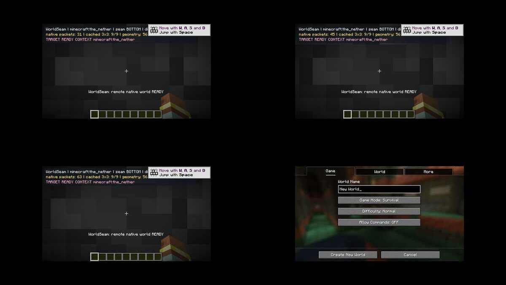

# WorldSeam 真实 Minecraft 图形客户端双向换维和夜视取证（2026-10-21）

- [原始 CI GitHub Actions Run 39563320927](https://github.com/g2066203208-beep/mc-studio/actions/runs/39563320927)。
- [夜视截图原件](worldseam-neoforge-nightvision-e2e-20261021.jpg)，来自软件 OpenGL / Xvfb 中运行的真实 Minecraft 1.21.1 + NeoForge 21.1.248；夜视是游戏内真实 Night Vision 状态效果，仅在 CI E2E 测试期间添加，没有后期美化。
- 自动化在新的单人生存存档中清理一个测试接缝并预加载：**9/9** 原生目标区块。完整 Chunk 传输 + ClientLevel 预热成功，包含 56,894 个几何候选表面，其中每帧渲染上限 3,500 个。
- 日志 **四项确认通过**：WORLDSEAM_E2E_PASS_CLIENT、WORLDSEAM_E2E_PASS_SERVER、WORLDSEAM_E2E_PASS_RETURN_CLIENT、WORLDSEAM_E2E_PASS_RETURN_SERVER。确认主世界↔下界方向的客户端与内置服务端都完成无原版 Respawn 维度切换。
- **非常重要**：游戏截图中仍主要显示近处石块表面和调试 HUD，没有拍到用户需要的“地狱抬头直接看到主世界、完整地平线连续且无遮挡的无缝视野”。因此不能宣布视觉无缝完成；目前 E2E 通过的仅是玩家无原版加载包的双向客户端/服务端换维。需继续做跨世界深度裁剪、正确的目标世界整场景合成和动态光照/块实体/实体同步。

