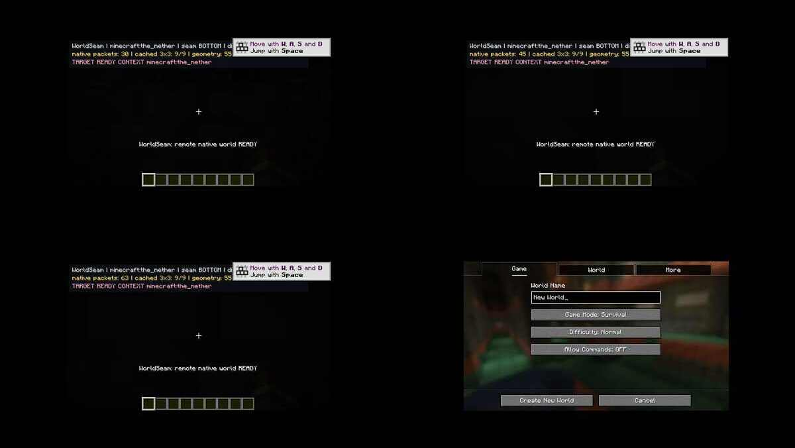

# WorldSeam 实际 Minecraft 图形客户端截图（2026-10-21）

- 来源：GitHub Actions [39562168565](https://github.com/g2066203208-beep/mc-studio/actions/runs/39562168565)，job 119095768136。
- Minecraft 1.21.1 / NeoForge 21.1.248；GitHub Actions Xvfb 虚拟图形桌面，真实游戏单人世界。
- 图片：[原始截图四格合集](worldseam-neoforge-client-e2e-20261021.jpg)，由 CI 图形客户端直接 `xwd` 截屏合成，保留真实暗部，不是 AI 绘制/模拟效果。
- 自动验收：`WORLDSEAM_E2E_PASS_CLIENT`、`WORLDSEAM_E2E_PASS_SERVER`、`WORLDSEAM_E2E_PASS_RETURN_CLIENT`、`WORLDSEAM_E2E_PASS_RETURN_SERVER` 全部出现；流程没有使用原版 respawn 换维代码路径。
- 测得远端原生区块缓存 9/9，native packets 9，geometry 55,017，单帧绘制上限 3,500。
- **关键限制**：截图视觉仍偏暗，不能证明用户要求的上下世界已经像 Immersive Portals Dimension Stack 一样完全可见；完整 portal-plane depth compositing、多维块实体与光照/音效/粒子/模型、Sable 相容仍未验收。此次成功只是两方向真实客户端+服务端维度切换，不意味着真正视觉无缝完成。
- **CI-only** 开关 `-PworldseamE2E`，不会在用户正常运行的 mod jar 中默认执行破坏性 setup-test。

